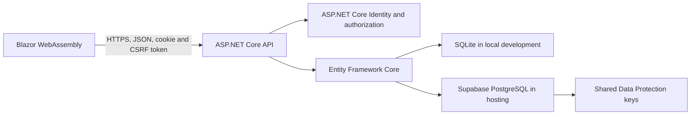

# SkillSnap: engineering case study

SkillSnap is an independent portfolio application covering a complete workflow: discover a session, create an account, reserve a seat, and manage attendance. It is intended to make the implementation and its limits easy to inspect. It was developed with AI assistance; the repository and checks are evidence of the resulting work, not a claim of unaided authorship.

## Architecture

The hosted container serves the browser application and API from one origin. The browser never receives database credentials. Identity remains in ASP.NET Core; Supabase supplies PostgreSQL rather than a second authentication system.

## Decisions worth discussing

- **Cookies and CSRF:** login cookies are HttpOnly; mutations require a CSRF token. Authentication alone does not establish ownership of another account's booking.
- **Role freshness:** Organizer permission is read from the database rather than relying on a role copied into an older cookie. Signup cannot choose its own role.
- **Booking races:** a remaining-seat display can become stale. PostgreSQL writes acquire a lock on the session row before checking capacity; organizer capacity edits use the same lock. SQLite uses conditional atomic writes. Tests cover simultaneous requests.
- **Conflicting edits:** session and attendance revisions reject a stale save rather than silently overwriting a newer change.
- **Provider differences:** local development needs only .NET and SQLite. Hosted PostgreSQL has its own migrations and concurrency handling; passing SQLite tests alone would not establish PostgreSQL correctness.
- **Attendance is separate from registration:** clearing attendance returns a booking to NotRecorded; it does not cancel the booking. Recorded attendance blocks cancellation until cleared.

## Deployment problem and resolution

The first hosted walkthrough exposed a real scaling issue: separate Vercel containers held session-pooler connections and reached Supabase's session limit. Moving to transaction pooling avoided reserving a PostgreSQL backend for each idle client. A repeated-request check then caught driver connection-reset timeouts; applying Npgsql's transaction-pooler compatibility option resolved that check.

The resulting runtime configuration disables automatic prepared statements, uses short idle lifetimes, preserves certificate verification with Supabase's public CA, and skips migrations on Vercel cold starts. Hosted migrations are a controlled deployment step. Database-backed cookie keys allow containers to validate the same login cookie.

Evidence: 24 repeated/concurrent API reads passed with the corrected connection settings; hosted signup, registration, filtering, reload persistence, cancellation, organizer editing, and attendance correction/clearing were checked in the browser. This is a bounded functional check, not a production load-test result or uptime guarantee.

## Verification

- 64 integration tests run once against SQLite and once against PostgreSQL in CI.
- CI builds the production image and checks database health, the session listing, browser fallback routes, missing API routes, and relative frontend API configuration.
- Browser walkthroughs verify both learner and Organizer flows. Browser automation is not part of the committed CI test suite.
- [CI results](https://github.com/robcorbisiero/SkillSnap/actions) and [test source](../tests/SkillSnap.Api.Tests) are inspectable evidence.

## Limits and next work

The demo has fictional programme data, owner-controlled Organizer provisioning, no email verification or password recovery, and no claim of production-grade observability. Account rate limiting is per application instance. The hosted demo stays behind Vercel Authentication. Public access needs a separate readiness review, not merely removal of protection.

Useful next improvements are mail-backed recovery, browser tests, and shared account abuse controls. These are planned work, not completed features.
