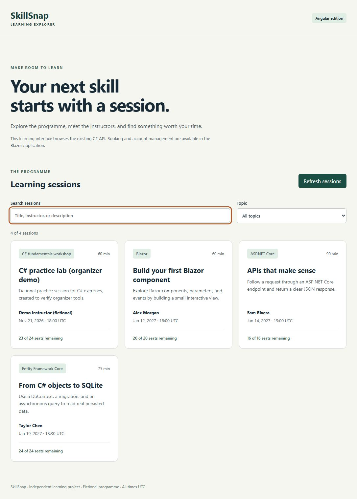

# Angular learning companion

A small read-only Angular 22 / TypeScript client for SkillSnap's existing ASP.NET Core API. Built with AI assistance as an introductory exercise; the Blazor application remains the full client. No embedded-device, Angular expertise, authentication or booking implementation is claimed here.

## Run locally

Prerequisites: .NET 10 SDK and Node.js 26 (tested with 26.13.0). Install dependencies from the committed lockfile.

Terminal 1, repository root:

```powershell
dotnet run --project src/SkillSnap.Api --launch-profile http
```

Terminal 2, repository root:

```powershell
cd examples/angular-learning
npm ci
npm start
```

Open http://127.0.0.1:4200. The development proxy sends `/api/**` requests to http://127.0.0.1:5080. The API reads its existing local SQLite database. No new database, cloud account, credentials or CORS changes are required. All programme times are UTC. API startup applies the existing migrations and seeds fictional sessions if needed.

```powershell
npm test -- --no-watch
npm run build
```

The production output is `dist/angular-learning/browser`. The development proxy is not a production backend configuration. This example is not wired into the Vercel deployment; the hosted app continues to use Blazor.

## Architecture to explain

- `src/app/app.ts` uses Angular dependency injection to obtain `HttpClient` and sends `GET /api/learning-sessions`.
- The TypeScript interface describes the JSON contract; it is not runtime payload validation.
- Signals hold sessions, filters, loading and error state. Computed signals derive the topic list and filtered sessions without further network requests.
- The template renders loading, failure, empty and successful states. DatePipe displays UTC times. A ten-second timeout releases the loading state when a request stalls.
- The C# endpoint owns database access and availability calculations. Filtering here is client-side; it is suitable for this small demo, not a large paginated catalogue.

## Personal walkthrough

1. Search for `SQLite`, then clear it and choose a topic. Explain why filtering does not request the API again.
2. Search for a nonexistent term and explain the empty state.
3. Stop only your local API, select Refresh sessions and observe the error. Restart the API, then Retry. Explain why stale sessions were cleared and why retry is safe for a GET request.
4. Find `LearningSessionDto` and compare its JSON field names with `LearningSession` in the Angular client.
5. Add a duration filter yourself, then modify a meaningful test. Practise debugging a failing assertion and an HTTP failure in your editor.

The three component tests exercise filtering through DOM controls, HTTP-failure retry, and clearing stale sessions on an empty refresh. They use Angular's HTTP testing controller; they are not live-backend tests. Separately, on November 15, 2026, browser verification loaded four real local API sessions, found SQLite via search, and displayed the no-results state. No account or booking mutations were made.



Reference: [official Angular dev-server proxy guidance](https://angular.dev/tools/cli/serve) and [Angular testing](https://angular.dev/guide/testing).
